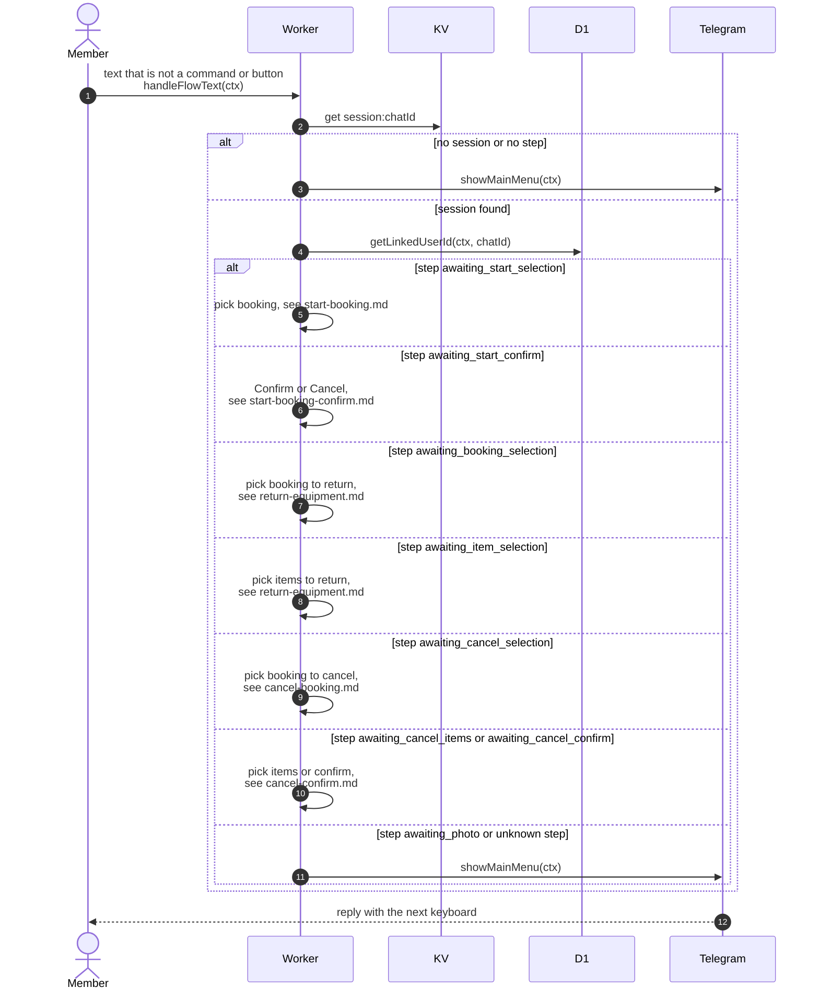

# Multi-step conversations through the text router

> **Question:** How does the bot continue a conversation when a
> member taps a button or types text in the middle of a flow?
>
> **Answer:** The bot keeps one saved step per chat in KV
> (`session:CHATID`, expires after 1 hour). `handleFlowText` reads
> it and sends the text to the matching step. With no saved step
> the text shows the main menu. If the member is no longer linked
> in a step that needs an account, the main menu is usually shown.
>
> **Notes:**
> - The 8 steps are `awaiting_booking_selection`,
>   `awaiting_item_selection`, `awaiting_photo`,
>   `awaiting_start_selection`, `awaiting_start_confirm`,
>   `awaiting_cancel_selection`, `awaiting_cancel_items` and
>   `awaiting_cancel_confirm`.
> - Steps that show the main menu when the chat is not linked:
>   `awaiting_start_selection` (after a valid booking button),
>   `awaiting_start_confirm`, `awaiting_item_selection`,
>   `awaiting_cancel_items` and `awaiting_cancel_confirm`. Picking
>   a booking at `awaiting_booking_selection` or
>   `awaiting_cancel_selection` gives "Please link your account
>   via /start first." instead.
> - `awaiting_photo` has no text handling. Text sent then falls to
>   the main menu (default branch). Only a photo moves it on.
> - Saving a step again restarts the 1 hour expiry. Nothing deletes
>   a session explicitly.
> - Unlike the list commands, `handleFlowText` has no error catch,
>   so a thrown error ends the update with 500 (see `webhook.md`).
> - Each step is detailed in the file named on its arrow.

