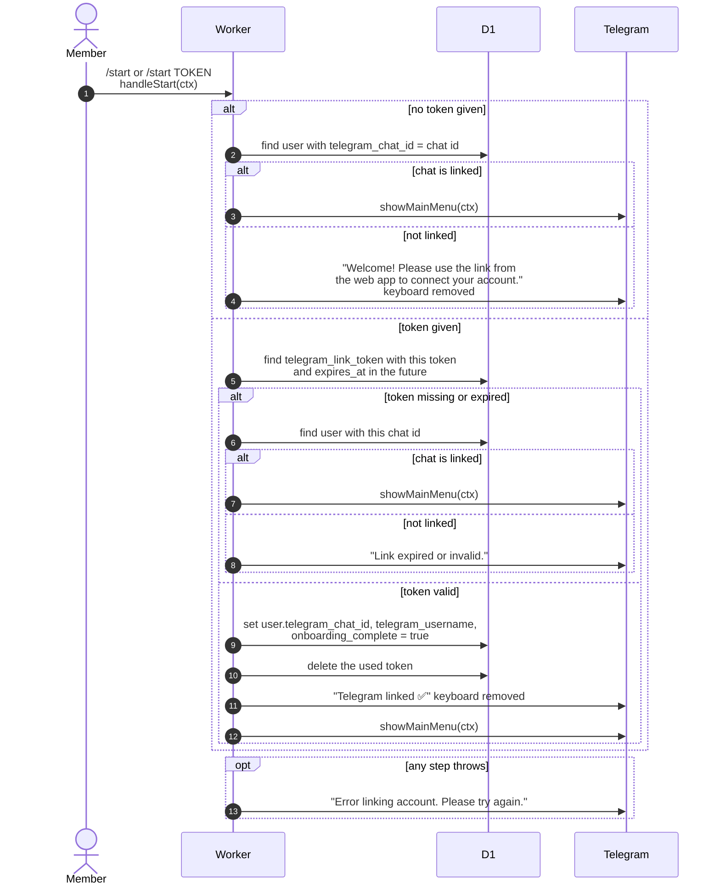

# Linking or relinking a Telegram account with /start

> **Question:** What happens when someone opens the bot with
> `/start`, with or without a link token?
>
> **Answer:** With a valid, unexpired token the bot saves the
> chat id and Telegram username on the member's account, marks
> onboarding complete, deletes the token, then replies "Telegram
> linked ✅" and shows the main menu. This also moves an already
> linked account to a new chat (relinking). A bad or expired
> token gets "Link expired or invalid.", unless the chat is already
> linked, in which case it just shows the menu. `/start` with no
> token shows the menu to linked chats and a welcome text to others.
>
> **Notes:**
> - The token is the word after `/start` (split on a space).
> - Linking sets `onboarding_complete` to true, so finishing the
>   link in Telegram completes the onboarding step.
> - Relinking from a new chat overwrites the old chat id. The old
>   chat then counts as unlinked.
> - The code does not check whether the chat is already linked to
>   a different account before saving.
> - A used token is gone, so tapping the same link twice from a
>   linked chat shows the menu instead of an error.
> - Token creation is in `link-token-create.md`.

