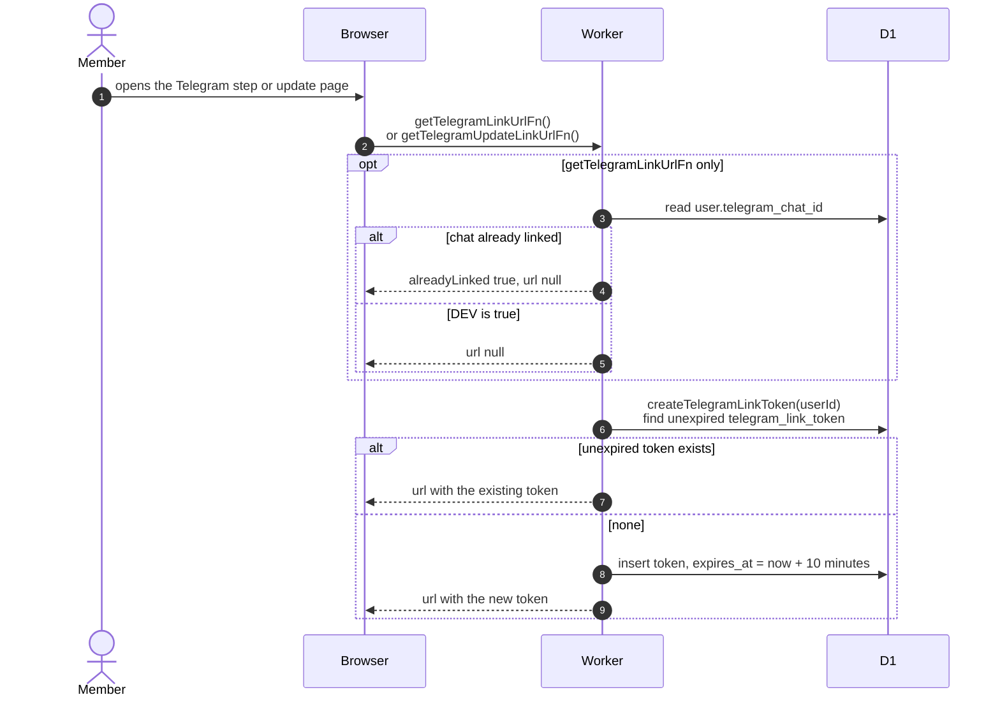

# Creating the link a member taps to connect Telegram

> **Question:** Where does the Telegram link a member taps come
> from, and how long does it work?
>
> **Answer:** When the web app asks for a Telegram link, the Worker
> makes a link of the form `https://t.me/BOT?start=TOKEN`. It reuses
> the member's existing unexpired token if there is one, otherwise
> it stores a new random token that lasts 10 minutes. Tapping the
> link opens the bot and sends `/start TOKEN`, handled in
> `link-account.md`.
>
> **Notes:**
> - `createTelegramLinkToken` is a plain helper, not a server
>   function. `getTelegramLinkUrlFn` (onboarding) and
>   `getTelegramUpdateLinkUrlFn` (changing the linked chat) both
>   call it. The pages that show the link belong to `../account/`.
> - `getTelegramLinkUrlFn` returns no link when the account already
>   has a chat linked (`alreadyLinked`), and returns no link when
>   the server runs with `DEV=true`. `getTelegramUpdateLinkUrlFn`
>   always makes a link.
> - The reused token keeps its original expiry, so the link may
>   have under 10 minutes left.
> - BOT is `TELEGRAM_BOT_USERNAME`, or `your_equipment_bot` if unset.
> - The token is a UUID with the dashes removed (32 characters).

