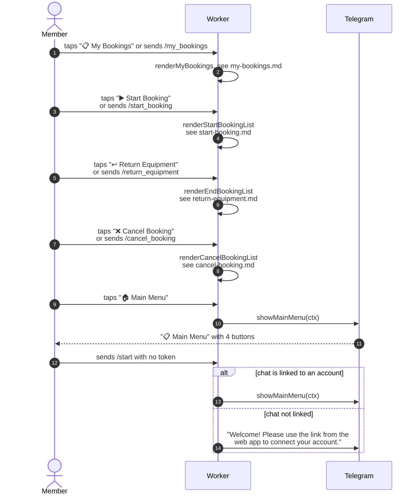

# Main menu and keyboard buttons

> **Question:** What does each button on the bot's keyboard do?
>
> **Answer:** The four menu buttons open the member's bookings, the
> start list, the return list and the cancel list. The "🏠 Main
> Menu" button shows the menu again. Tapping a button sends its
> label as an ordinary text message, so each label is handled
> exactly like the matching slash command.
>
> **Notes:**
> - Menu text is "📋 Main Menu" then "Choose an action below:".
> - Besides the emoji labels, these plain labels also work: "My
>   Bookings", "Start Booking", "End Booking" (return) and "Cancel
>   Booking".
> - The keyboard stays on screen until a reply removes it. Replies
>   telling an unlinked person to link remove it.
> - The bot's command list (set with Telegram `setMyCommands`) has
>   only `/start`, described as "Open the main menu". It is
>   refreshed by `configureTelegramBot` in the scheduled run, which
>   spends 1 unit of the run budget. See `../cron/overview.md`.
> - Each list is detailed in `my-bookings.md`, `start-booking.md`,
>   `return-equipment.md` and `cancel-booking.md`.

