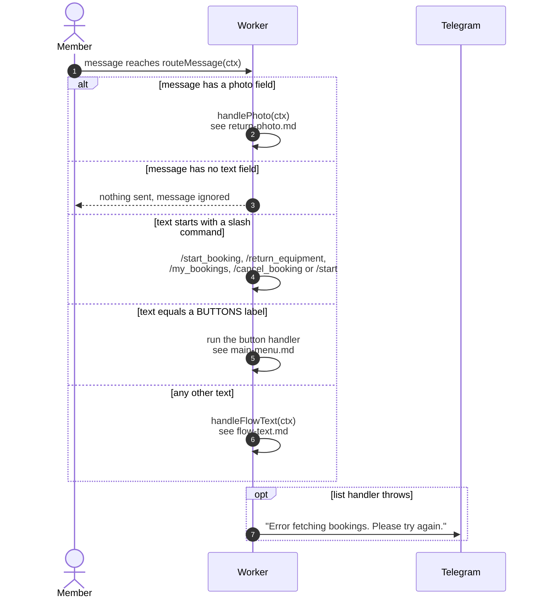

# How the bot decides what to do with a message

> **Question:** Which handler runs when someone writes to the bot,
> and which messages are ignored?
>
> **Answer:** A photo goes to `handlePhoto`. A text message is
> checked against the slash commands first, then against the
> keyboard button labels, and anything else goes to the step
> router, which reads the person's saved step. With no saved step
> it shows the main menu. Messages with neither photo nor text
> (stickers, voice, and so on) are ignored without any reply.
>
> **Notes:**
> - Slash commands match by the start of the text. `/start_booking`
>   is tested before `/start`, so it is not taken for `/start`.
>   Any text beginning with `/start`, `/start_booking`,
>   `/return_equipment`, `/my_bookings` or `/cancel_booking`
>   counts, even with extra characters after it.
> - Commands and buttons run the same list handlers. The emoji
>   label and a plain label are both accepted for each action.
>   See `main-menu.md` for the exact table.
> - Handler errors in the four list handlers are caught and answer
>   "Error fetching bookings. Please try again."
> - Step handling is in `flow-text.md`. Photo handling is in
>   `return-photo.md`.

