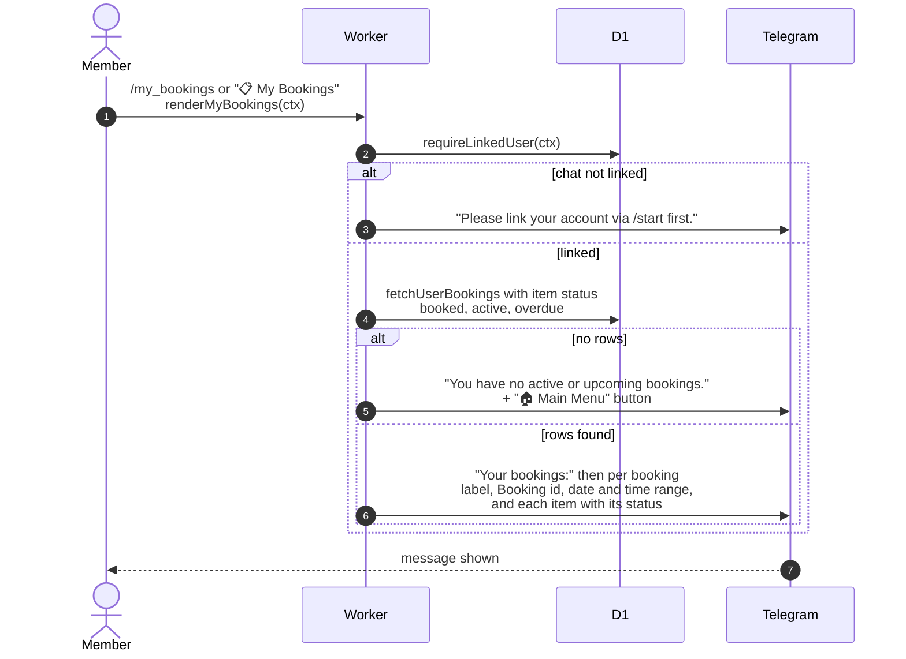

# Listing my bookings in Telegram

> **Question:** What does `/my_bookings` show?
>
> **Answer:** It lists the member's bookings that are upcoming,
> active or overdue, with the date, the start and end times in club
> time, and each piece of equipment with its status. If there are
> none it says "You have no active or upcoming bookings."
>
> **Notes:**
> - Bookings are chosen by item status (booked, active, overdue),
>   so a partly returned booking appears only through its items
>   that are still out.
> - A booking is labelled "Upcoming", "Active", "Overdue" or
>   "Partially Returned" by its own status.
> - Read-only. No session is saved.

