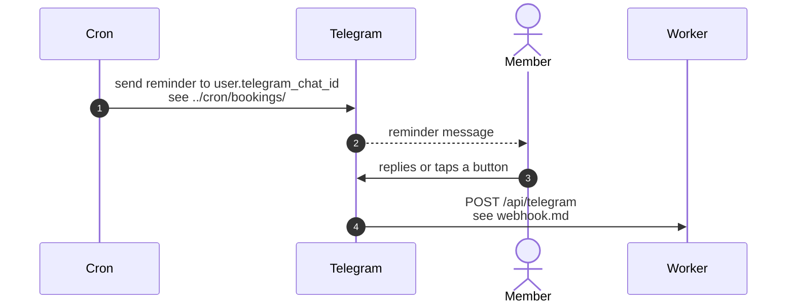

# Reminder messages sent to members

> **Question:** Where do the bot's reminder and warning messages
> come from?
>
> **Answer:** They do not come from a member's message. The
> 5-minute cron sends them straight to the member's linked chat.
> The bot's webhook never sees them and has no handler for them.
>
> **Notes:**
> - Reminder timing, wording and the sent-at markers are described
>   in `../cron/bookings/`.
> - The same cron run also refreshes the bot's command list with
>   `configureTelegramBot`. See `main-menu.md`.
> - A member who replies to a reminder is handled like any other
>   message, see `message-routing.md`.

