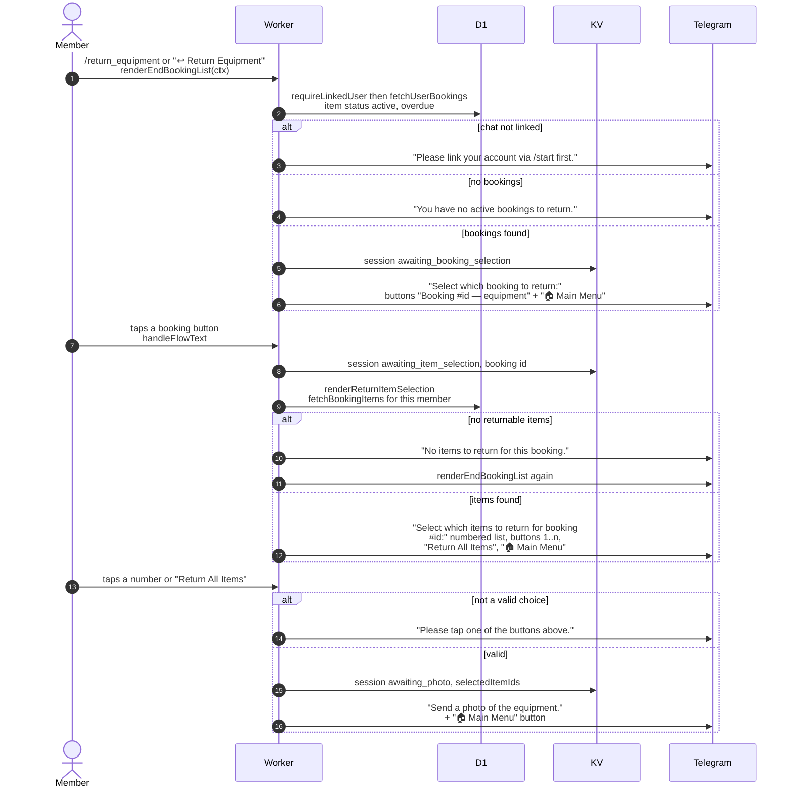

# Choosing what to return in Telegram

> **Question:** What happens when a member taps "Return Equipment"
> or sends `/return_equipment`?
>
> **Answer:** The bot lists the member's bookings that have picked
> up equipment (active or overdue items), then the items of the
> chosen booking as numbered buttons plus "Return All Items".
> After a choice it asks for a photo of the equipment, which is
> handled in `return-photo.md`.
>
> **Notes:**
> - Only items with status active or overdue can be returned. Items
>   still "booked" must be cancelled instead. There is no time
>   filter, so a booking started early can be returned early.
> - The saved steps are `awaiting_booking_selection`, then
>   `awaiting_item_selection`, then `awaiting_photo`. Each save
>   expires after 1 hour in KV.
> - A choice that is not a button gets "Please tap one of the
>   buttons above."
> - If the chat is no longer linked, picking a booking gets "Please
>   link your account via /start first." and picking an item
>   shows the main menu.
> - Item numbers are positions in the list (1, 2, 3 ...), read back
>   against the current list of returnable items.

