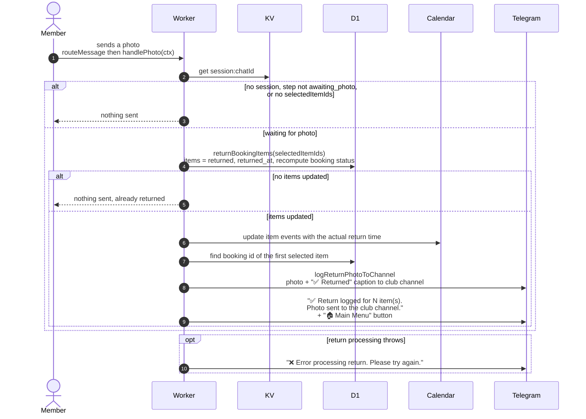

# Returning equipment with a photo

> **Question:** What happens when a member sends a photo after
> choosing items to return?
>
> **Answer:** If the chat is waiting for a photo, the selected
> items are marked returned, the booking status is recomputed, the
> calendar events are updated with the real return time, and the
> club channel gets the photo with a "Returned" caption. The member
> sees "✅ Return logged for N item(s)." and "Photo sent to the club
> channel."
>
> **Notes:**
> - The largest size of the photo is the one forwarded.
> - A photo is silently ignored (no reply) when there is no saved
>   step `awaiting_photo`, no selected items, or the items were
>   already returned (for example a photo sent twice).
> - The photo handler does not check that the chat is linked. It
>   relies on the saved selection.
> - On a database error the member sees "❌ Error processing
>   return. Please try again." and the saved selection stays. A
>   new photo retries only if the items were not already marked
>   returned.
> - "Photo sent to the club channel." is shown even when channel
>   logging is off or the post fails, because posting never
>   raises an error.
> - The saved step is not cleared and simply expires after 1 hour.
> - Calendar failures per item are logged to the console and do not
>   stop the return.
> - Previous steps are in `return-equipment.md`. The channel post
>   is in `channel-log.md`.

