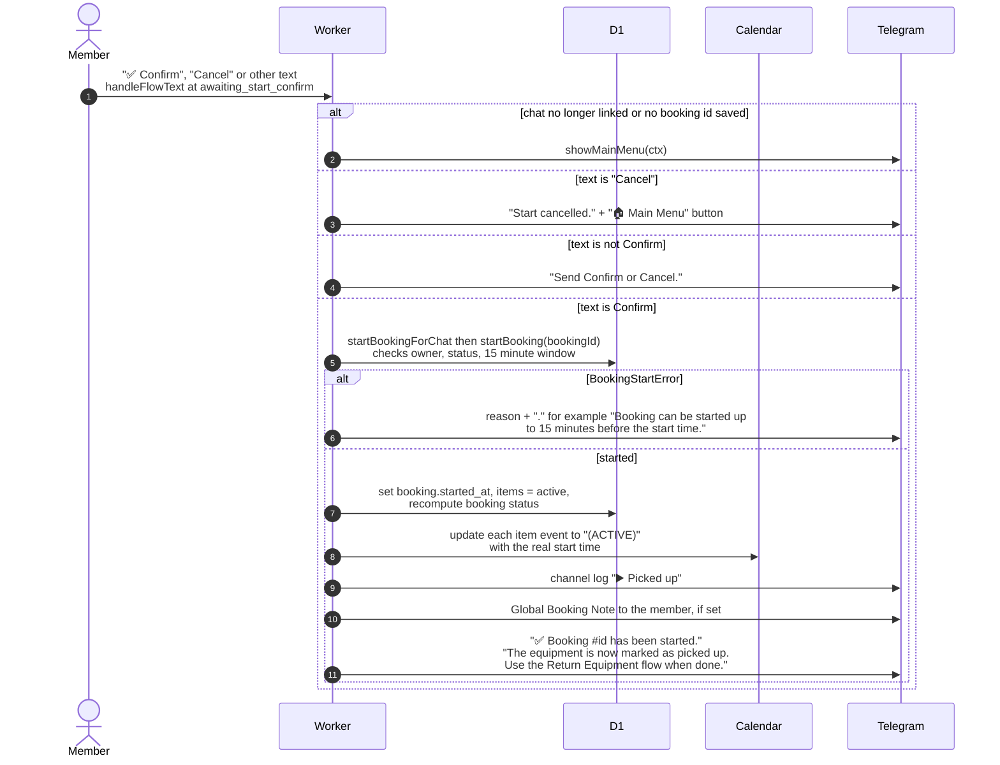

# Confirming the start of a booking in Telegram

> **Question:** What happens when the member taps Confirm or Cancel
> on the "Start booking now?" question?
>
> **Answer:** Confirm starts the booking: its items become active,
> the calendar events are updated, the club channel gets a "Picked
> up" log, and the member sees "✅ Booking #35;id has been started."
> If the booking cannot be started, the bot replies with the reason.
> Cancel replies "Start cancelled."
>
> **Notes:**
> - Starting uses the same `startBooking` as the web "Start pickup".
>   It only works for the booking's owner.
> - If the member has a Telegram chat and the settings have a Global
>   Booking Note, the note is sent as a separate message.
> - The saved step is not cleared after starting, so a second
>   Confirm within the hour gets the "cannot be started from status"
>   reply.
> - Other text gets "Send Confirm or Cancel."
> - Other refusals use the same pattern: "Booking not found.",
>   "Booking has already been started.", "Booking has no items
>   that can be started." and 'Booking cannot be started from
>   status "x".' A start after the window gets "Booking start
>   window has passed" and says the booking will be auto-cancelled.
> - Calendar and log failures are logged to the console only and do
>   not stop the start.
> - Channel logging is in `channel-log.md`.

