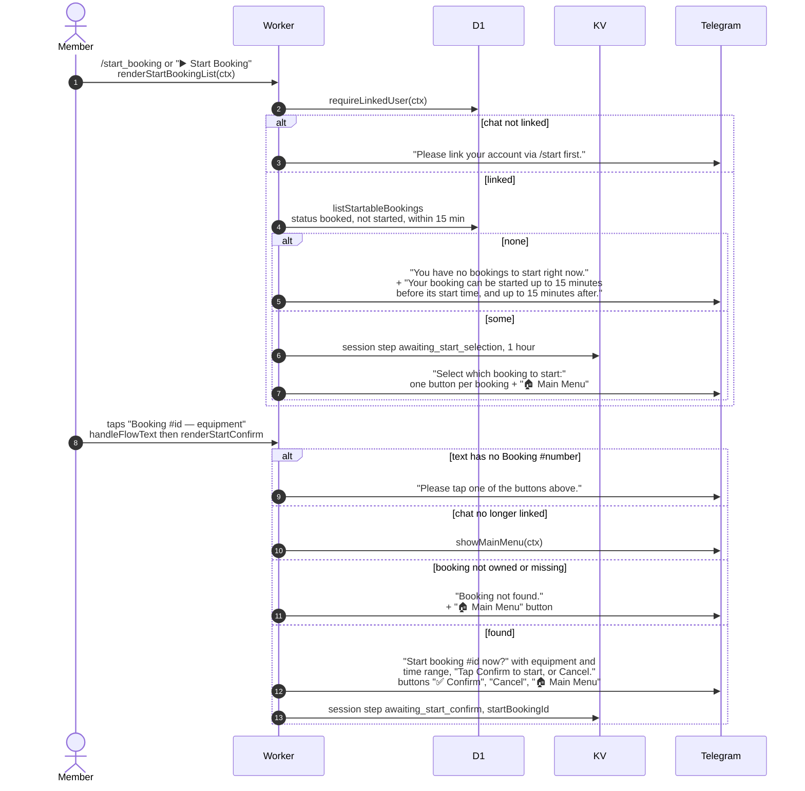

# Choosing a booking to start in Telegram

> **Question:** What happens when a member taps "Start Booking" or
> sends `/start_booking`, and picks a booking?
>
> **Answer:** The bot lists the member's bookings that are still
> "booked" and whose start window is open, as buttons. Tapping one
> shows its equipment and time and asks for Confirm or Cancel. If
> there is nothing startable it explains the 15 minute window.
>
> **Notes:**
> - Window: from 15 minutes before the start time to 15 minutes
>   after it, and the booking must not have been started.
> - Listing saves step `awaiting_start_selection` in KV with a
>   1 hour expiry. Picking saves `awaiting_start_confirm` and the
>   booking id, but only if the booking was found.
> - Button text is "Booking #35;id — equipment names". The id is read
>   back from that text. Any other text gets the "tap one of the
>   buttons" reply.
> - Confirming is in `start-booking-confirm.md`.

