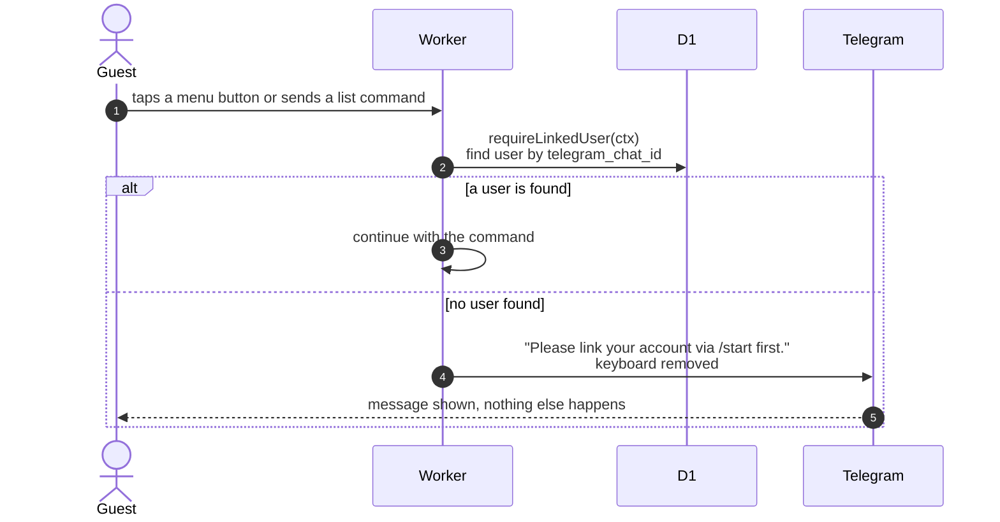

# What an unlinked chat sees

> **Question:** What happens when someone who has not linked their
> account uses the bot?
>
> **Answer:** Every list command and button (bookings, start,
> return, cancel) replies "Please link your account via /start
> first." and removes the keyboard, so nothing is shown or changed.
> The lookup is by chat id against the user's saved Telegram chat.
>
> **Notes:**
> - Typed text that is not a command or button shows the main menu
>   when the chat has no saved step. That menu is shown even to an
>   unlinked chat, but its buttons then give the message above.
> - If the link is lost in the middle of a flow, most steps show
>   the main menu. Picking a booking to return or cancel gets the
>   message above instead. See `flow-text.md`.
> - A photo from an unlinked chat is ignored (see `return-photo.md`).
> - Linking is explained in `link-account.md`.

