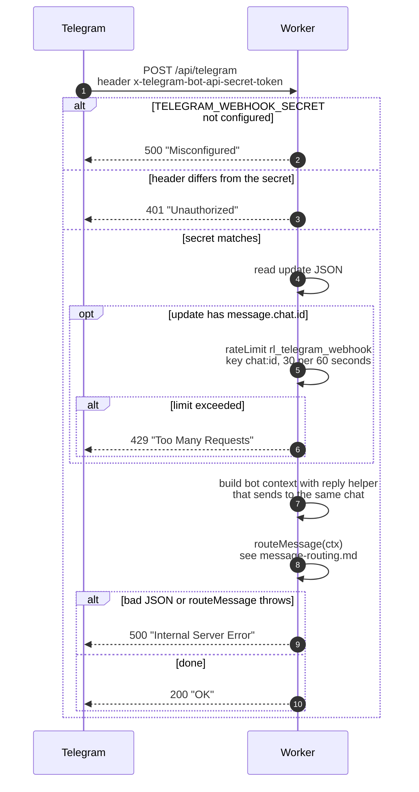

# Telegram webhook checks

> **Question:** What happens when Telegram sends an update to the
> bot, and when is it refused?
>
> **Answer:** Telegram posts every update to `/api/telegram`. The
> Worker first checks the secret header, then limits each chat to 30
> updates per minute, then hands the message to the router. Missing
> server secret gives 500, wrong secret gives 401, too many updates
> gives 429. Any other update, including ones with no message, gets
> 200 "OK".
>
> **Notes:**
> - The secret check fails closed. If the server has no secret set,
>   every update is refused with 500, not accepted.
> - The limit is keyed on the chat id, not the IP address, because
>   all updates come from Telegram's own addresses. The limit is 30
>   per 60 seconds (binding `rl_telegram_webhook`).
> - If the limiter binding is missing or throws, the update is
>   allowed through.
> - Updates with no message (for example edited messages) skip the
>   rate limit and are answered 200 by the router doing nothing.
> - A body that is not valid JSON, or any error in the router,
>   gives 500 "Internal Server Error".
> - Routing continues in `message-routing.md`.

